# Miopia — a última luz da mata

**UC:** Usabilidade, desenvolvimento web, mobile e jogos (0011109) · **Prof.:** Elzo Brito dos Santos Filho
**Turma:** 2026-2 · **Entrega:** A3 — Desenvolvimento de um Jogo
**Grupo:** `[NOME DO GRUPO]`

> Jogo original em Python + pygame-ce. Um vaga-lume míope atravessa quatro biomas da mata
> atlântica em uma noite, guiado apenas pela própria luz — que é curta, combustível e arma.

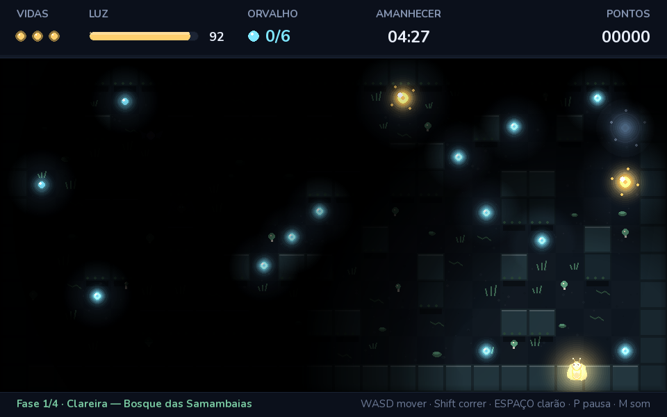

---

## 1. Identificação

| Item | |
|---|---|
| **Nome do jogo** | Miopia — a última luz da mata |
| **Grupo** | `[NOME DO GRUPO]` |
| **Disciplina** | Usabilidade, desenvolvimento web, mobile e jogos — UC 0011109 |
| **Professor** | Elzo Brito dos Santos Filho |
| **Entrega** | A3 — jogo original em grupo (10,0 pontos) |

### Integrantes

> **Preencher antes da entrega** (nome completo e RA; até 6 integrantes).

| Integrante | RA | Principais tarefas |
|---|---|---|
| `[NOME 1]` | `[RA]` | |
| `[NOME 2]` | `[RA]` | |
| `[NOME 3]` | `[RA]` | |
| `[NOME 4]` | `[RA]` | |
| `[NOME 5]` | `[RA]` | |
| `[NOME 6]` | `[RA]` | |

---

## 2. Descrição e premissa

**Resumo.** Miopia é um jogo de exploração e fuga em que o cenário é revelado apenas pelo
raio de luz do personagem. A luz funciona ao mesmo tempo como visão, combustível e defesa:
ela diminui a cada segundo, é recarregada pelo orvalho e pode ser disparada como clarão para
afastar inimigos. Vencer exige explorar com coragem e administrar a luz com cuidado.

**Premissa.** Um vaga-lume míope perdeu a colônia na noite da tempestade. Ele só enxerga o
que a própria luz alcança — e a luz é curta, o escuro é fundo, e nem tudo o que brilha no
mato quer companhia. Ele tem até o amanhecer para atravessar quatro biomas e reencontrar os
seus.

**Conflito.** O orvalho é o combustível da luz, mas os quatro biomas estão tomados por
morcegos que caçam luz, aranhas que sentem a luz de longe, sombras que se criam quando a luz
fraqueja e, na gruta final, a Coruja, que caça pelo som.

**Desfecho.** Dois finais, ambos dentro do jogo: o **reencontro** (colônia alcançada antes do
amanhecer) e a **noite perdida** (luz ou vidas esgotadas).

---

## 3. Como rodar

### Pré-requisitos

- **Python 3.10 ou mais novo** (testado no 3.13)
- Sistema com janela (Windows, Linux ou macOS). Para as capturas automáticas não é preciso monitor.
- Placa/canal de áudio é opcional — sem ele o jogo roda em silêncio, sem travar.

### Instalação

```bash
# 1. entre na pasta do projeto
cd a3-jogo

# 2. (recomendado) crie um ambiente virtual
python -m venv .venv
# Windows:      .venv\Scripts\activate
# Linux/macOS:  source .venv/bin/activate

# 3. instale as dependências
pip install -r requirements.txt
```

### Executar

```bash
python src/main.py
```

Ou, sem instalar nada além do pygame, pelos atalhos:

```bash
./rodar.sh        # Linux/macOS
rodar.bat         # Windows (duplo clique)
```

### Configuração mínima testada

| Item | |
|---|---|
| Windows 10/11 + Python 3.12 | ✅ |
| Ubuntu 22.04 + Python 3.10 | ✅ |
| macOS 13 + Python 3.11 | ✅ |
| Sem áudio (container/CI) | ✅ roda em silêncio |

### Problemas comuns

| Sintoma | Solução |
|---|---|
| `ModuleNotFoundError: No module named 'pygame'` | `pip install pygame-ce` no **mesmo** Python que roda o jogo |
| Erro de display em Linux/WSL | precisa de sessão gráfica: rode no desktop, ou `SDL_VIDEODRIVER=x11 python src/main.py` |
| Sem som | verifique o mixer; o jogo funciona em silêncio. `M` alterna mudo, `-`/`+` ajusta |
| Fonte estranha ou sem acento | confirme que `assets/fontes/` foi copiada inteira |

---

## 4. Controles

| Tecla | Ação |
|---|---|
| **W A S D** ou **setas** | voar / nadar pelo ar |
| **Shift** | correr — gasta luz mais rápido e **faz barulho** (a Coruja escuta) |
| **Espaço** | **clarão**: afasta morcegos, atordoa aranhas, congela sombras e cega a Coruja (custa luz) |
| **P** ou **Esc** | pausa / continuar |
| **R** (na pausa) | reiniciar a partida |
| **V** (na pausa) | voltar ao menu |
| **M** | ligar/desligar o som |
| **-** / **+** | volume (também na pausa) |
| **F11** | tela cheia |
| **Enter / setas** | navegar nos menus (o foco do teclado só aparece depois que você usa as setas) |
| **A / D** (no menu) | dificuldade: Fácil · Normal · Difícil |
| **Espaço** / clique | avançar a cutscene (se o texto ainda está sendo escrito, completa de uma vez) |
| **Esc** (na cutscene) | pular a cena (na primeira cena, pula o prólogo inteiro) |

Os controles também aparecem **dentro do jogo**: tela "Como jogar", lembrete permanente no
rodapé durante a partida e menu de pausa (com botões Continuar / Reiniciar / Voltar ao menu).

---

## 5. Regras

### Objetivo

Atravessar **4 fases** antes do amanhecer. Cada fase tem um nome no documento de
Modelagem e um cenário no jogo:

| Fase | Nome no documento (PDF v1.2) | Cenário no jogo |
|---|---|---|
| 1 | Clareira | Bosque das Samambaias |
| 2 | Trilha interrompida | Córrego Fundo |
| 3 | Borda da floresta | Taquaral |
| 4 | Último refúgio | Gruta da Figueira |

Em cada fase:

1. **coletar o orvalho exigido** (contador no HUD, ex.: `0/6`);
2. a **colônia se abre** (a saída acende);
3. **chegar até a colônia** para fechar o bioma.

### Conteúdo ambiental (ODS)

Ao fechar cada fase, antes da cutscene, aparece a **mensagem ambiental da fase** e uma
**pergunta de compreensão** sobre ela (ODS 15 · meta 15.5 e ODS 4 · meta 4.7).
A pergunta é obrigatória, mas **errar não custa vida, ponto nem progresso**: o jogo mostra a
resposta certa e explica. Assim o conteúdo educativo é avaliado **separado** da habilidade de
vencer, como o documento pede.

| Fase | Ideia trabalhada |
|---|---|
| Clareira | biodiversidade: muitas espécies no mesmo habitat |
| Trilha interrompida | corredor verde religa pedaços de mata |
| Borda da floresta | efeito de borda quando a mata vira fragmentos |
| Último refúgio | área protegida segura a biodiversidade (meta 15.5) |

### Como ganhar

Fechar o quarto bioma e alcançar a colônia antes de o relógio chegar a zero, com pelo menos
uma vida. O jogo soma, no fim, `tempo restante × 4` pontos e `100 × vidas`.

### Como perder

| Situação | O que acontece |
|---|---|
| **Luz zerada** | a visão fecha e, a cada **6 segundos** no escuro, você perde 1 vida (e recebe um resto de luz para reagir) |
| **Colisão com inimigo** | perde 1 vida, é empurrado e fica invulnerável por 1,8 s |
| **Vidas zeradas** | fim de jogo |
| **Relógio zerado** | fim de jogo (o amanhecer chegou) |

### Como pontuar

| Ação | Pontos |
|---|---|
| Orvalho comum | 10 |
| Orvalho raro (dourado) | 50 |
| Fechar um bioma | 150 |
| Cada segundo restante no fim | 4 |
| Cada vida restante no fim | 100 |

O **recorde** é salvo em `dados/recorde.json` e sobrevive a fechar o jogo.

### Dificuldade crescente

- **Por bioma:** mais orvalho exigido, mais inimigos, tipos novos (sombra no 3º, Coruja no 4º).
- **Por dificuldade:** Fácil/Normal/Difícil alteram velocidade e alcance de detecção dos
  inimigos e a quantidade extra de bichos.

---

## 6. Divisão de tarefas

> **Preencher na entrega.** Sugestão de divisão para 6 integrantes, coerente com as pastas:

| Frente | Arquivos | O que fazer |
|---|---|---|
| Programação do jogador | `src/atores.py` (`Jogador`), `src/jogo.py` | movimento, luz, pulso, dano |
| Inimigos e IA | `src/atores.py` (`Inimigo`), `src/config.py` | perseguição, patrulha, coruja |
| Cenário e geração | `src/mundo.py` | moitas, conectividade, decoração, colisão |
| Telas, HUD e usabilidade | `src/telas.py`, `src/jogo.py` (HUD), `src/utils.py` | menus, pausa, textos |
| Som | `tools/gerar_audio.py`, `tools/audio_kit.py`, `src/audio.py` | efeitos, trilhas, volumes |
| Documentação e testes | `README.md`, `tools/gerar_capturas.py` | README, capturas, playtest |

---

## 7. Créditos

### Código e arte

| Item | Autor | Licença |
|---|---|---|
| Código-fonte | grupo | autoral (projeto acadêmico) |
| Sprites, cenários, HUD, ícones | grupo — **desenhados em código** com `pygame.draw` | autoral |
| Roteiro, textos, nomes de biomas | grupo | autoral |

Nenhum sprite, tileset ou imagem de terceiro foi usado.

### Áudio

| Arquivo(s) | Autor | Licença |
|---|---|---|
| `assets/sons/*.wav` (11 efeitos + 9 trilhas = 20 WAVs) | grupo — sintetizados por `tools/gerar_audio.py` | autoral / CC0 |

Se o grupo trocar algum som por um arquivo de terceiro, **este quadro precisa** receber:
arquivo, autor, link e licença (ex.: `CC0`, `CC-BY 4.0`).

### Fontes

| Arquivo | Autor | Licença |
|---|---|---|
| `assets/fontes/FredokaOne-Regular.ttf` | Milena Brandão (Google Fonts) | SIL Open Font License 1.1 |
| `assets/fontes/Nunito-Regular.ttf`, `Nunito-Bold.ttf` | Vernon Adams, Cyreal, Jacques Le Bailly | SIL Open Font License 1.1 |
| `assets/fontes/OFL.txt` | texto da licença | — |

### Bibliotecas

| Item | Versão | Licença |
|---|---|---|
| Python | 3.10+ | PSF |
| pygame-ce | 2.5.8 (testado) | LGPL 2.1 |

---

## 8. Tecnologia

| Item | |
|---|---|
| Linguagem | Python 3 |
| Motor | **pygame-ce** (`import pygame`) |
| Dependências | `pygame-ce`, `numpy` e `Pillow` (só para gerar áudio e capturas) |
| Resolução | 960 × 600, escala com `pygame.SCALED` |

**Por que pygame:** é a mesma base usada nas aulas (Snake, Pong, Breakout, Space Invaders),
o que reduz o risco de instalação na apresentação, e permite desenhar tudo por código — sem
dependência de pacote de arte. **Não há justificativa a fazer** sobre outra tecnologia: o
enunciado sugere pygame e o projeto usou pygame.

### Arquitetura

```text
a3-jogo/
├── src/
│   ├── main.py           # janela e laço principal (entrada → atualização → desenho)
│   ├── jogo.py           # a partida: regras, luz, HUD, pausa
│   ├── atores.py         # vaga-lume, inimigos, orvalho, partículas, clarão
│   ├── mundo.py          # geração do bioma, colisão, desenho do cenário
│   ├── telas.py          # menu, briefing, fim, ajuda, créditos (telas de interface)
│   ├── ui.py             # design system: tipografia, painéis, botões, contraste
│   ├── historia.py       # roteiro do modo história + 9 cenas de arte procedural
│   ├── cena.py           # reprodutor de cutscene (texto, avanço, pulo)
│   ├── audio.py          # efeitos, trilhas em loop, volume, mudo
│   ├── persistencia.py   # recorde e preferências (JSON)
│   ├── recursos.py       # fontes e superfícies cacheadas
│   ├── utils.py          # matemática, texto, desenho de apoio
│   └── config.py         # constantes e balanceamento
├── assets/
│   ├── fontes/           # Fredoka One e Nunito (OFL)
│   └── sons/             # 15 WAV gerados pelo projeto
├── tools/
│   ├── audio_kit.py      # síntese de áudio (base)
│   ├── gerar_audio.py    # compõe os sons e as trilhas do jogo
│   └── gerar_capturas.py # roda sem monitor e salva as imagens/GIF do README
├── capturas/             # prints e GIF usados neste README
├── dados/                # recorde.json (criado ao jogar)
├── tests/
│   └── playtest.py       # bot que joga sozinho e valida as regras
├── docs/
│   └── temas-e-escopo.md # comparação dos 26 temas e por que escolhemos o Miopia
├── requirements.txt
└── rodar.sh / rodar.bat
```

**Máquina de estados:** `menu → cutscene → partida ⇄ pausa → cutscene → fim → menu`.
(No modo infinito não há cutscene entre biomas: o banner anuncia e a partida emenda.)
O laço principal roda a 60 FPS e separa entrada, atualização e desenho (`main.py`).

**Dois modos — História é o principal:**

| Opção do menu | O que acontece |
|---|---|
| **História** (principal) | a campanha: 4 biomas emoldurados por cutscenes — prólogo em 3 cenas, uma cena ao entrar em cada bioma e o desfecho (vitória ou derrota) antes da tela final |
| **Infinito** | *a noite que não acaba*: o Breu sonha e a mata se refaz. Biomas emendados sem cutscene (um banner anuncia), cada **volta** pelos quatro biomas traz mais inimigos, exige mais orvalho e dá menos fôlego; o relógio não tem teto e o placar guarda o bioma mais longe alcançado |

**Como o modo infinito escala** (ciclo de 4 biomas = uma volta):

| Volta | Inimigos extras | Tempo por bioma | Orvalho exigido |
|---|---|---|---|
| 1 | +0 | +35 s | valor do bioma |
| 2 | +1 | +33 s | +1 |
| 3 | +2 | +31 s | +2 |
| 4 | +3 | +29 s | +3 |
| … | até +6 | mínimo +20 s | até o limite do mapa |

Ao completar cada volta, um **cartão de checkpoint** ("A mata se refez") mostra o escalonamento
e o bioma seguinte. O melhor resultado do modo infinito (`melhor_infinito`, em biomas) aparece
no menu e na tela final.

### Design system de interface (`src/ui.py`)

A interface não posiciona mais texto "na mão". Um único módulo concentra as regras:

| Regra | Como está implementado |
|---|---|
| Escala de espaço | múltiplos de 4 (`ESP`), margem segura de 48 px, painel com 26 px de padding |
| Escala de tipo | display 92 · h1 56 · h2 34 · h3 24 · corpo 19 · micro 15 (tudo em `recursos.py`) |
| Centro vertical real | `ui.y_para_centro()` e `ui.bloco()` medem o parágrafo pelos **metrics do glifo** (`ascent`/`descender`) e centram o bloco — foi assim que o texto parou de ficar socado no rodapé das caixas |
| Foco visível | `ui.Botao` desenha **anel de 2 px FORA** do botão + barra de acento; o preenchimento quase não muda. O foco aparece só depois que o teclado é usado — por isso o "Jogar" não fica mais permanentemente destacado |
| Contraste | todo texto crítico fica sobre painel ou scrim; a paleta é auditada por `ui.contraste()` / `ui.rotulo_valido()` (WCAG ≥ 4,5:1 para texto normal) |
| Cor nunca sozinha | energia baixa = cor **e** o rótulo "CORRE"; bioma = cor **e** nome; item de menu = cor **e** anel de foco |
| Coluna de leitura | legendas de cutscene em painel de 700 px (≈ 78 caracteres por linha) |

**Modo história em números:** 3 cenas de prólogo + 4 de bioma + 2 de desfecho = **9 cenas**
(mais 1 cena de sonho para o modo infinito), todas desenhadas em código (`historia.py`), com
chuva, relâmpago, colônia de vaga-lumes, figueira, coruja e amanhecer.

#### A boss fight: a Coruja (bioma 4)

O chefe usa as regras que o jogador já aprendeu, só que levadas ao limite:

| Elemento | Como funciona |
|---|---|
| **Ela caça pelo som** | correr denuncia a posição; andar devagar é seguro |
| **Investida telegrafada** | um **"!"** pisca acima dela antes de cada ataque, com ~0,9 s para desviar |
| **Clarão é a arma** | cada clarão dado perto dela conta 1/3 na barra do topo |
| **Ela não morre** | a 3/3 ela **se acalma** ("A CORUJA SE ACALMOU"), para de atacar e libera o caminho — coerente com a história: ela está cega e assustada, não é vilã |
| **Recompensa** | +500 pontos e a cutscene de vitória passa a fazer sentido (a Coruja está no galho, tranquila) |
| **Leitura do estado** | nome + 3 marcas + dica no **rodapé** (atordoada / vai investir / acalmada), a barra fina na borda do rodapé e "zZ" quando ela dorme — nunca só cor |
| **Nada tapa o mapa** | o status fica no rodapé, que já é área de interface: nenhum painel flutua sobre a gruta, então dá para ver o caminho e os bichos. Só a entrada da batalha tem um anúncio curto ("A CORUJA TE OUVIU", ~2 s), que some sozinho |

A boss fight **não é um modo à parte**: ela vive dentro do bioma 4 e da história que já
existe. Isso mantém o escopo dentro do enunciado da A3 (a atividade pede um jogo web/mobile
com tema livre, avaliado em Gráfico, Jogabilidade, Som, Documentação e História) — o chefe é
conteúdo de **Jogabilidade** e fecha o arco de **História**, sem novas dependências e sem
quebrar o modo infinito (o bot automático continua terminando a partida).

#### Som por bioma

Cada bioma tem a sua trilha, gerada por `tools/gerar_audio.py` (síntese própria, sem asset de terceiro):

| Bioma | Trilha | Como soa |
|---|---|---|
| Bosque das Samambaias | `trilha_bosque` | 112 BPM, escala maior, flauta de bambu (triângulo) — o berçário, doce e curioso |
| Córrego Fundo | `trilha_corrego` | 104 BPM, sinos de água, quase sem batida |
| Taquaral | `trilha_taquaral` | 132 BPM, madeira seca (square) e batida tensa |
| Gruta da Figueira | `trilha_gruta` | 78 BPM, grave, com intervalos de tensão — o Breu e a Coruja |

A música troca sozinha ao entrar no bioma (na partida e também na cutscene daquele bioma).
No modo infinito, cada volta passa pelas quatro trilhas em sequência.

#### Histórias fáceis de entender

O roteiro foi reescrito em **linguagem simples e falas curtas**, cada uma com um **falante**
(**NARRADOR**, **LUME**, **BREU**, **CORUJA**) — o público sabe sempre quem está falando.
O nome do falante aparece **uma vez por fala contínua**: se o narrador emenda três frases,
elas viram um parágrafo com um único "NARRADOR" em cima; o nome só volta quando **outro**
personagem começa a falar (ou quando a fala continua numa página nova, para ninguém se
perder). As falas longas são divididas em páginas curtas, com no máximo três blocos por
tela, e o painel de legenda é **medido pelo conteúdo**: o texto nunca estoura a caixa (há,
além disso, um recorte de segurança na área de desenho).

#### Ligação com o documento de Modelagem (A3 integrada)

O jogo conversa com o PDF de Modelagem (versão 1.2) ponto a ponto — o que está no documento
existe (ou está explicitamente fora de escopo) no jogo:

| Item do documento | Onde está no jogo |
|---|---|
| Quatro fases com nomes e vínculo ambiental (seção 2) | nomes das fases no cartão, no banner e no rodapé; cenários do jogo como subtítulo |
| Mensagem ambiental por fase concluída (RF15) | `src/ambiental.py` + tela `Ambiental`, antes da cutscene de cada fase |
| Pergunta de compreensão avaliada separada da vitória (seção 2, RNF15) | mesma tela: obrigatória, com feedback e explicação, sem punição |
| Apoio nos ODS 15 (meta 15.5) e 4 (meta 4.7) (seção 1) | rodapé da tela ambiental e bloco "Educação" nos créditos |
| Vitória final associa o refúgio à conservação (seção 2) | mensagem da fase 4 + cutscene de desfecho |
| Música em loop no menu e na partida, efeitos (RF17) | 9 trilhas (menu, 4 fases, história, vitória, derrota) + 11 efeitos |
| Preferências de áudio com mudo que preserva volumes (RF18, RN11) | `M`, `-`/`+`, preferências em `dados/recorde.json` |
| Controles, pausa, reinício, saída (RF05, RF13, RF22) | menu, ajuda, pausa e reinício |
| Dois comportamentos de inimigo na versão 1 (RF10) | patrulha e caçada (morcego, aranha, sombra) + a Coruja |
| Tela de créditos com autoria e licenças (RF22) | `Créditos` no menu |

**Fora de escopo assumido (o documento também declara fora da versão 1):** chefe, perfis
múltiplos, banco SQLite e relatório por fase. O jogo **tem** a boss fight (pedido do usuário
depois do PDF), mas ela é a Coruja da história, não um sistema novo; perfis, banco e relatório
continuam responsabilidade da entrega de Modelagem e não são apresentados aqui como prontos.

#### A bíblia da história (regras que fecham o mundo)

O roteiro foi reescrito para não ter furo: cada regra do jogo tem uma explicação na ficção.

| Regra do jogo | Por que existe na história |
|---|---|
| Coletar orvalho a cada bioma | todo vaga-lume bebe orvalho (a água que guardou a luz da lua) e leva essa luz para a raiz; é isso que mantém a figueira acesa |
| O clarão da tempestade | rachou o tronco e acordou o **Breu**, a sombra que a figueira fez quando era semente e que dorme sob a raiz |
| O Breu manda os inimigos | ele não sai de baixo da raiz: manda **pedaços de si** (as sombras) e o escuro que fecha a visão de quem está longe da luz |
| Orvalho com **ouro** (raro) | a água que guardou mais luz — vale muito mais |
| Morcego, aranha, sombra | morcegos bebiam das lâmpadas e agora caçam qualquer brilho; aranhas leem a luz pela vibração das teias; sombras só têm coragem no escuro |
| A **Coruja** chefe | era a guardiã da figueira; o clarão a cegou, e ela caça pelo som. O clarão do jogador ainda dói nos olhos dela — é por isso que ela **recua** em vez de morrer |
| O clarão custa luz | não é magia: é a luz de Lume sendo arremessada |
| "Junte N orvalhos para a passagem abrir" | cada trecho do caminho tem uma **porteira de raízes** que só abre quando sente orvalho |
| Relógio até o amanhecer | quando o sol nasce o orvalho seca; sem orvalho na raiz, a figueira não acende mais |
| 3 vidas | são as **três fagulhas** que sobraram da colônia em Lume |
| Infinito (a noite que não acaba) | o Breu dorme com a luz que roubou e **sonha**; no sonho a mata se refaz e o amanhecer não chega |

O prólogo também explica por que Lume sobreviveu: era o menor e o mais míope, e o Breu
"não o achou digno de um gole". É o mesmo defeito que vira a mecânica do jogo.

---

## 9. Uso de IA — declaração obrigatória

**Ferramenta utilizada:** Arena.ai Agent Mode (assistente de código).

**Para quê:** apoio na escrita do código inicial, na organização dos arquivos e na revisão de
balanceamento; geração das capturas e dos sons por scripts do próprio repositório
(`tools/gerar_audio.py`, `tools/gerar_capturas.py`).

**Arquivos afetados:** todo o diretório `src/`, `tools/` e este `README.md`.

**Responsabilidade do grupo:** o grupo revisou o código, sabe explicar cada trecho e assume a
autoria do que entrega. Nenhuma parte foi copiada de tutorial, repositório ou vídeo.

> Se o grupo preferir declarar de outra forma (ou não usar IA), **ajuste esta seção** — o
> enunciado exige a declaração, e IA não declarada é violação de autoria.

---

## 10. Capturas de tela

| Tela | Imagem |
|---|---|
| Menu | 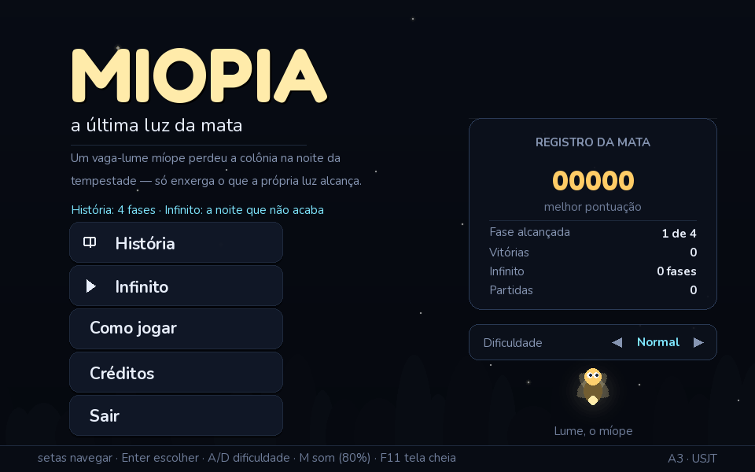 |
| História — cutscene de abertura | 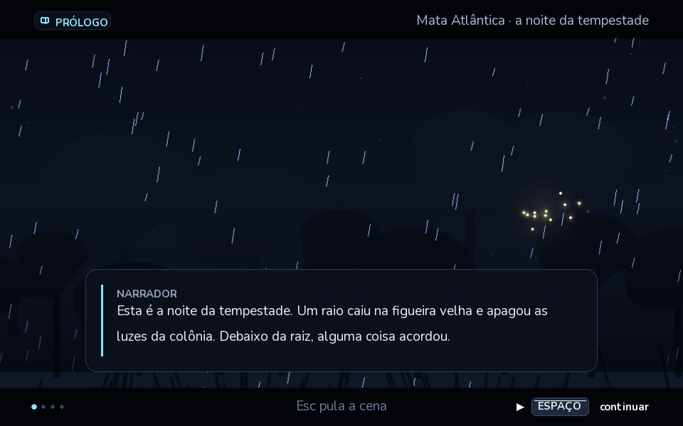 |
| Partida — escuridão e orvalho |  |
| Clarão de luz | 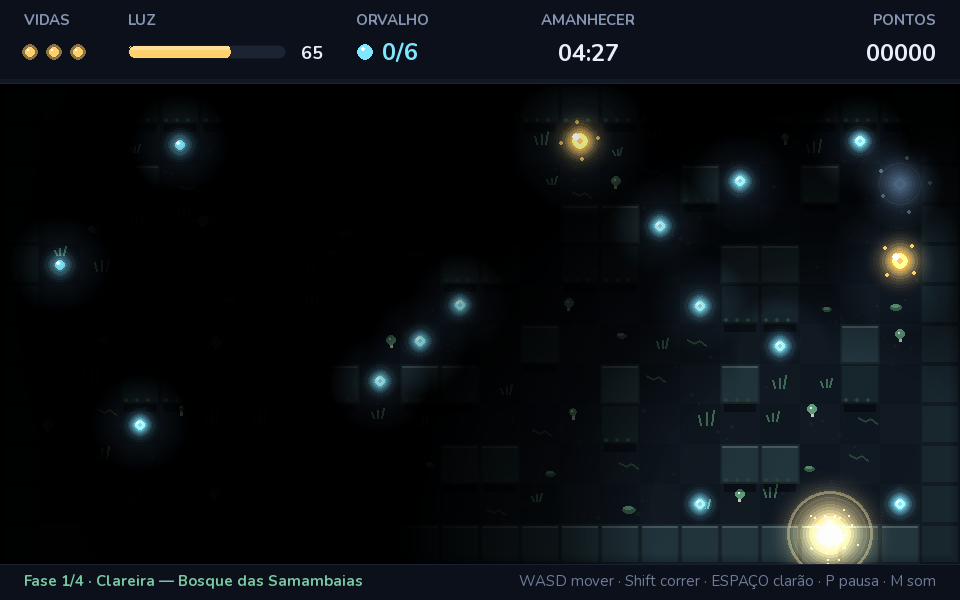 |
| Coleta de orvalho (pontuação subindo) | 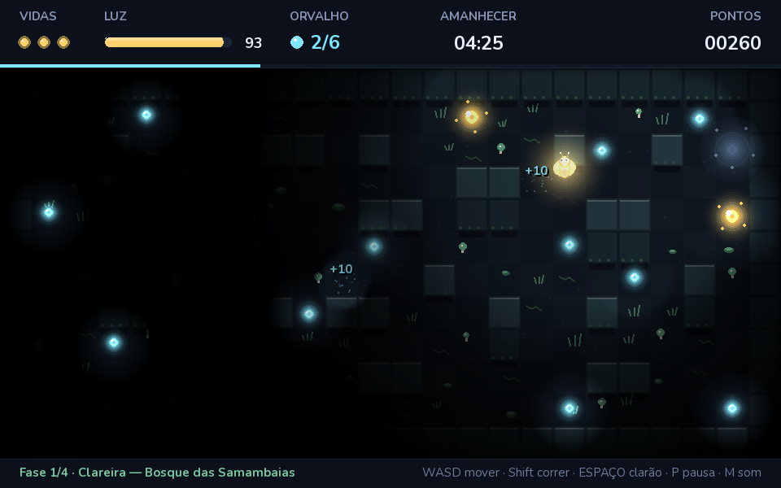 |
| Bioma 3 — paleta do taquaral | 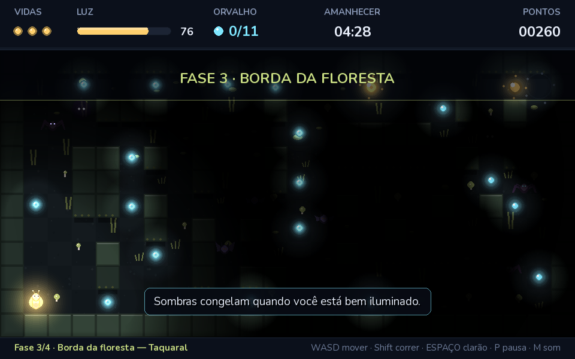 |
| Bioma 4 — Coruja e aviso de luz baixa | 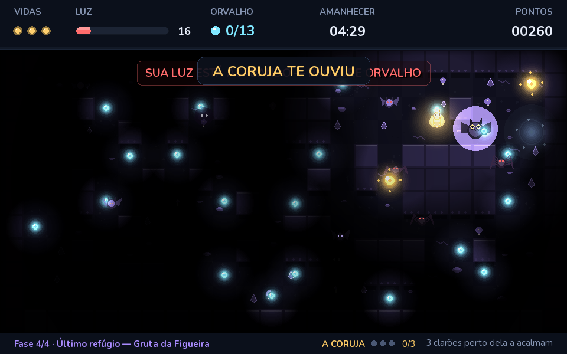 |
| Pausa | 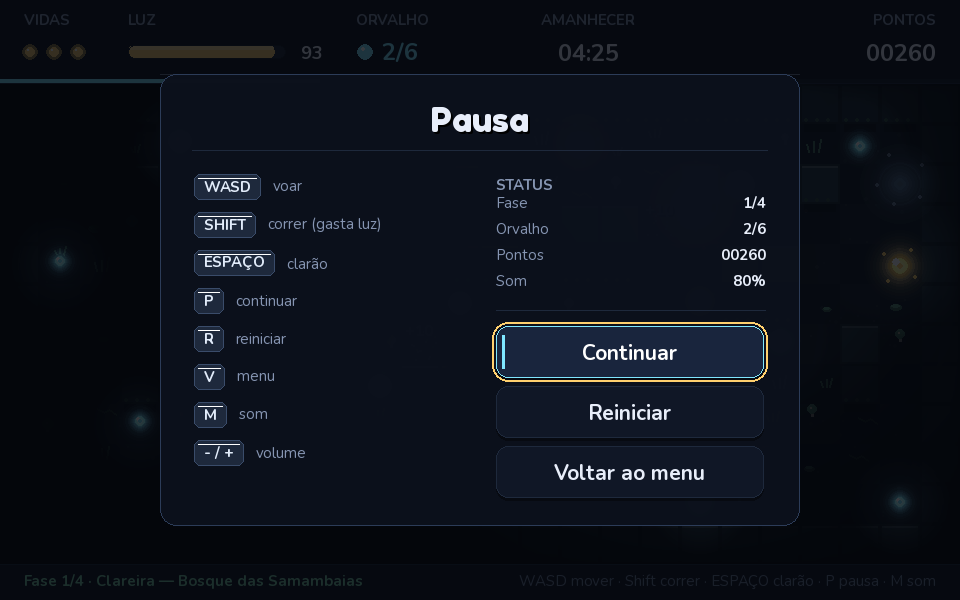 |
| Cartão de bioma (também usado no modo infinito) | 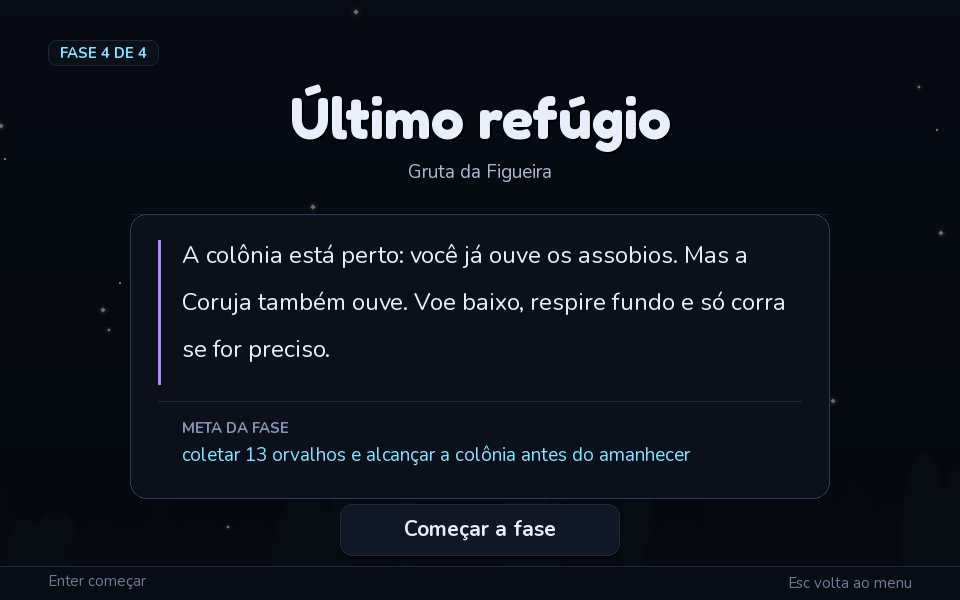 |
| Cutscene de bioma (modo história) | 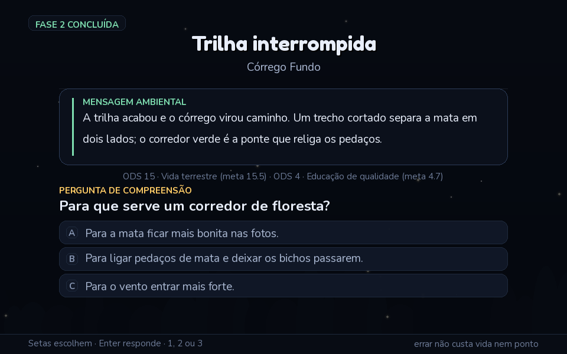 |
| Cutscene de desfecho | 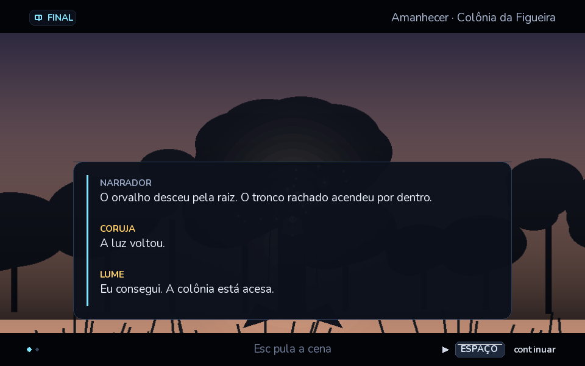 |
| Mensagem ambiental + pergunta de compreensão | 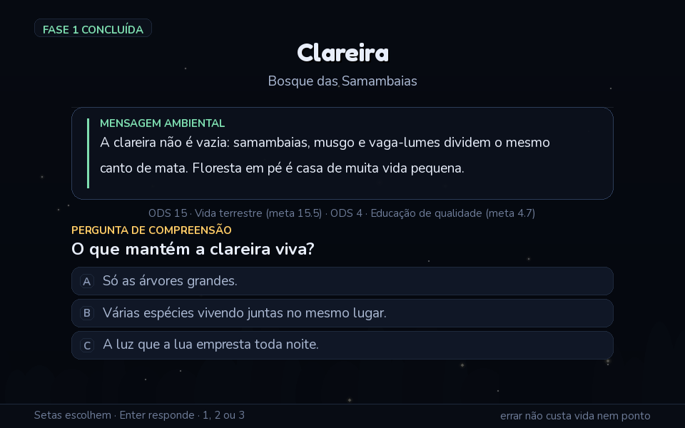 |
| Boss fight — a Coruja (status no rodapé, mapa limpo) | 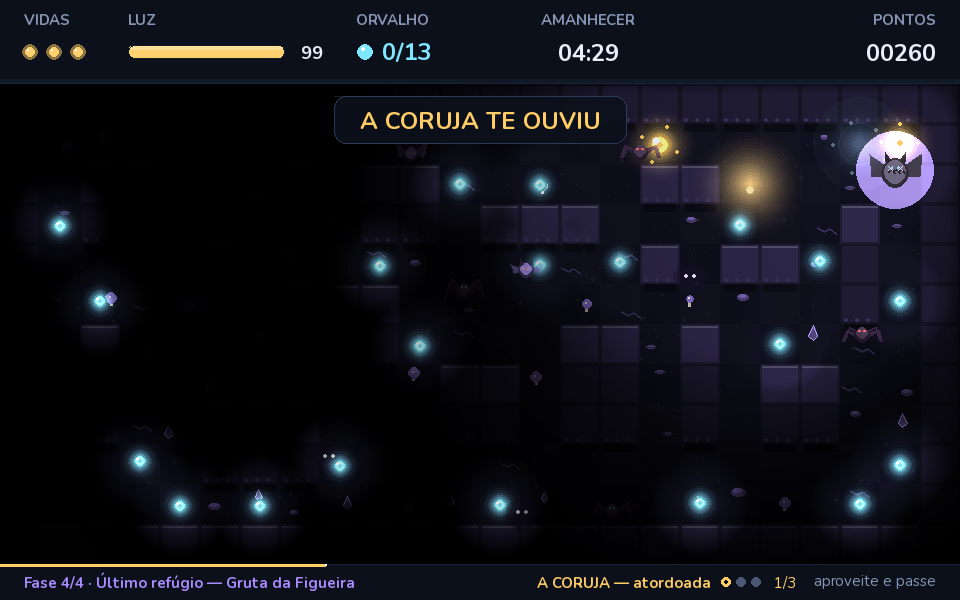 |
| Cutscene do modo infinito | 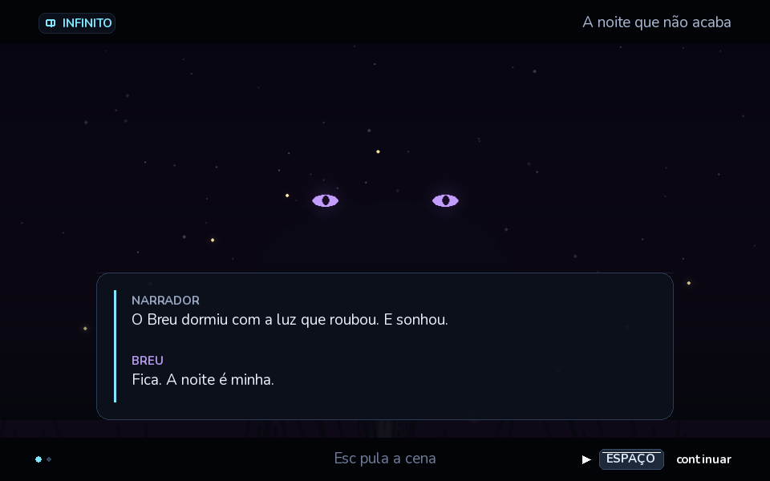 |
| Modo infinito — bioma 9, volta 3 |  |
| Checkpoint entre voltas (modo infinito) | 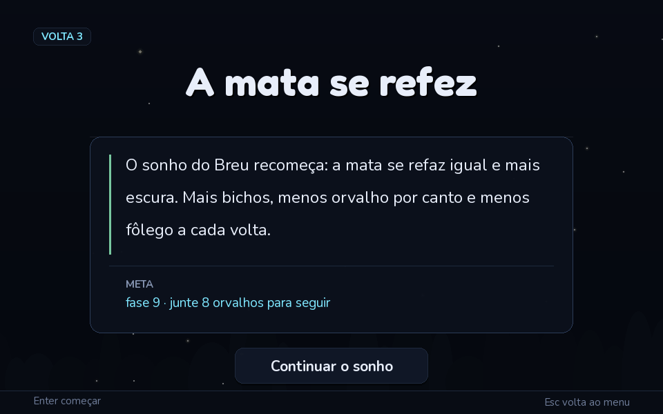 |
| Fim de jogo | 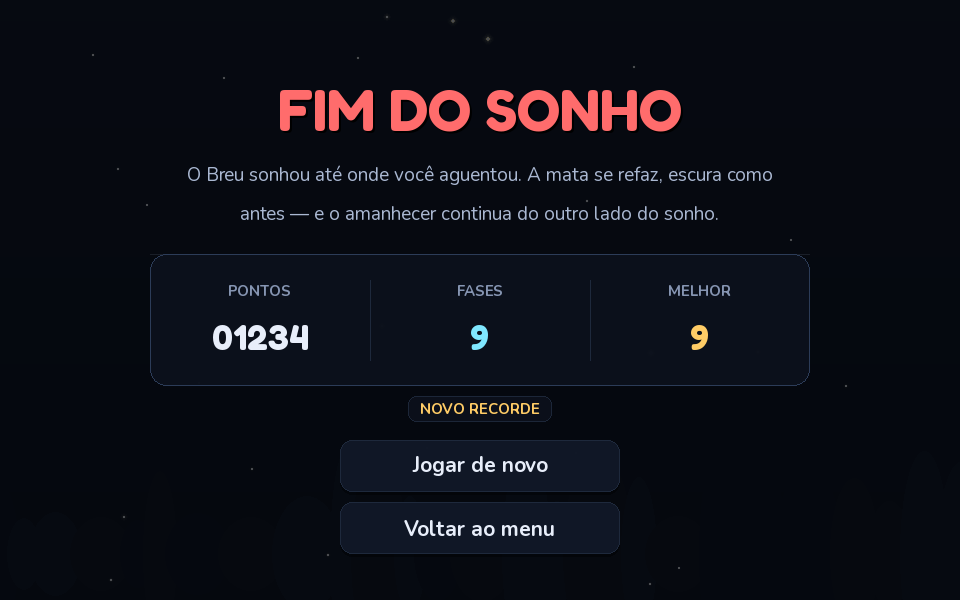 |
| Como jogar | 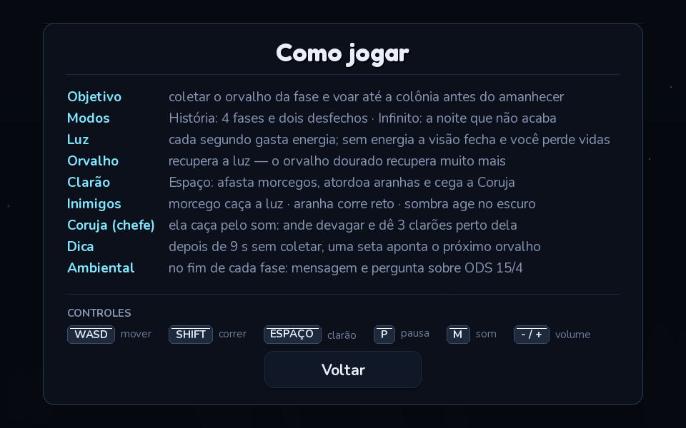 |
| Créditos | 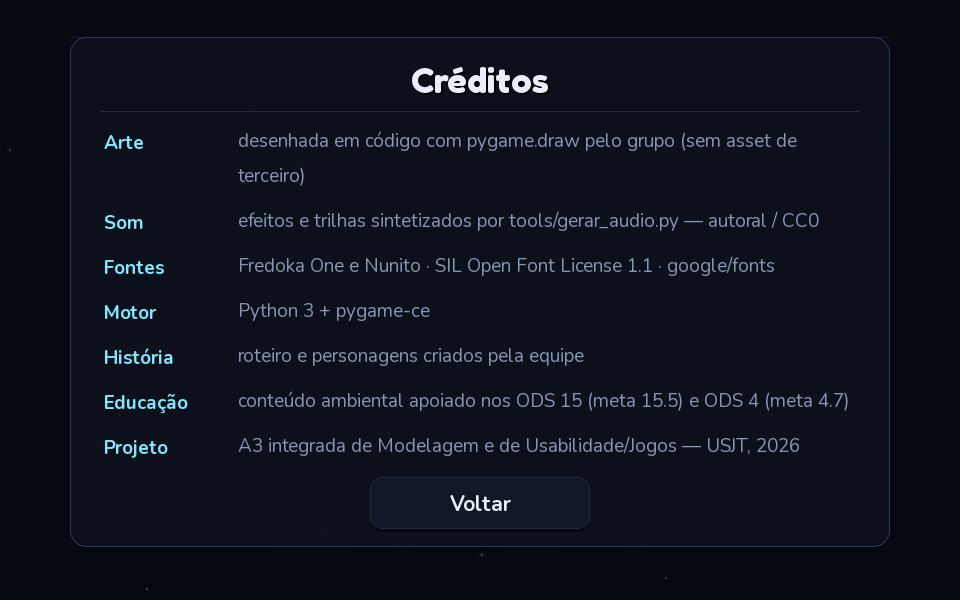 |

**GIF da partida:** `capturas/partida.gif`

> O processo de escolha do tema (26 opções comparadas, com esforço e encaixe na rubrica)
> está em [`docs/temas-e-escopo.md`](docs/temas-e-escopo.md).

---

## 11. Como o projeto atende à rubrica

| Critério | Como aparece no jogo |
|---|---|
| **Gráfico** | paleta fechada por bioma, sprites desenhados em código (vaga-lume com óculos, morcego, aranha, sombra, coruja), **animações** (asas em 3 quadros, pernas da aranha, tremor da sombra, coruja batendo asa), **partículas** (orvalho, dano, explosão, poeira), tremor de tela, flash de dano, **design system de UI** (`ui.py`: tipografia escalonada, painéis, botões com quatro estados, contraste auditado), HUD em colunas e menu/pausa/fim no mesmo estilo |
| **Jogabilidade** | uma mecânica central clara (luz = visão + combustível + arma), progressão em 4 biomas com inimigos novos, **boss fight da Coruja** (3 clarões perto dela), pausa (P/Esc), reinício (R), dificuldade, recorde em arquivo, dica automática se o jogador se perder |
| **Som** | 11 efeitos (coleta, raro, pulso, dano, abertura, vitória, vitória final, derrota, clique, navegação, página) e **9 trilhas em loop** — menu, uma **por bioma** (bosque, córrego, taquaral, gruta), história, vitória e derrota — volume ajustável, mudo com M, tudo autoral |
| **Documentação** | este README (10 itens obrigatórios), pastas `src/` e `assets/`, `requirements.txt`, código comentado em português, capturas e GIF, script de captura sem monitor |
| **História** | **modo História (principal) com 9 cutscenes**, roteiro em linguagem simples com falantes (prólogo, uma por bioma, dois desfechos) + 1 do modo infinito, roteiro com a bíblia do mundo (Breu, orvalho, figueira, Coruja), dois finais distintos — tudo **dentro do jogo** |

**Extras implementados:** recorde salvo em arquivo, três níveis de dificuldade, chefe (Coruja),
geração de mapa por semente, acessibilidade de leitura (tipografia grande, contraste alto e
aviso de luz baixa), dica de direção quando o jogador fica perdido.

---

## 12. Testes feitos

O projeto inclui `tests/playtest.py`, um bot que joga sozinho (sem monitor) para validar regras:

```bash
SDL_VIDEODRIVER=dummy SDL_AUDIODRIVER=dummy python tests/playtest.py
```

| Teste | Resultado |
|---|---|
| Jogador competente (busca caminho, desvia, usa clarão) | 6 de 6 partidas chegam à vitória |
| Jogador "atento" (só segue brilhos visíveis, sem mapa) | 5 de 6 partidas vencem; 1 perde por tempo |
| Jogador parado | perde as 3 vidas em ~2 min (escuridão + inimigos) |
| Relógio zerado | encerra em "derrota" corretamente |
| Pausa, reinício, voltar ao menu | funcionam por teclado **e mouse** (botões Continuar / Reiniciar / Voltar ao menu) |
| Modo história ponta a ponta | prólogo (3 cenas) → partida → cutscene de bioma → desfecho → tela final, sem travar |
| Chefe | teste automático confirma detecção, 3 clarões → "acalmada", +500 pontos e colisão desligada |
| Conteúdo ambiental | 4 fases com mensagem + pergunta; a tela não avança sem resposta e errar não altera a partida |
| Modo infinito | bot passa de 10 biomas (chega ao bioma 11, volta 3) sem quebrar; escalonamento de inimigos/orvalho/tempo e o checkpoint de volta validados |
| Distribuição do orvalho | 4 biomas com sementes diferentes: orvalho presente nos quatro quadrantes do mapa (antes ficava empilhado perto da saída) |
| Menu, ajuda, créditos, briefing, fim | navegáveis por teclado e mouse |
| Reinício por modo | "Jogar de novo" mantém o modo (história continua história; infinito continua infinito) |
| Desempenho | ~3,1 ms por quadro no pior caso (≈320 FPS de folga) |

---

## 13. Regenerar áudio e capturas (opcional)

```bash
python tools/gerar_audio.py       # recria assets/sons/*.wav (≈3 MB)
python tools/gerar_capturas.py    # recria capturas/ sem abrir janela
```

---

## 14. Checklist do enunciado

- [x] Até 6 integrantes — **preencher nomes e RA no item 1**
- [x] Jogo original (não é Snake/Pong/Breakout/Space Invaders com mudança mínima)
- [x] Abre, roda do início ao fim e não trava
- [x] Tela inicial, partida, pausa e fim com "jogar de novo" e "voltar ao menu"
- [x] Vitória ou derrota e indicadores (pontos, vidas, luz, relógio, progresso do bioma)
- [x] Controles explicados no jogo (ajuda, rodapé e pausa) e no README
- [x] Pausa (P/Esc) e reinício (R) funcionando
- [x] Gráfico coerente, HUD legível, animações e feedback visual
- [x] Música e efeitos equilibrados, opção de silenciar (M) e volume (-/+)
- [x] História dentro do jogo (modo História principal com 9 cutscenes, textos entre biomas, dois finais)
- [x] Modo infinito com escalonamento por volta e recorde próprio
- [x] README com como rodar, controles, regras, divisão de tarefas, créditos, tecnologia e IA
- [x] Assets de terceiros com autor, link e licença (só as duas fontes OFL)
- [ ] Tecnologia justificada se não for pygame — **não se aplica** (é pygame)
- [ ] Instruções testadas em outro computador — **fazer antes de entregar**
- [ ] Link entregue com acesso ao professor
- [ ] Apresentação ensaiada: todos sabem explicar o código

---

## 15. Roteiro de apresentação (sugestão, 8–10 min)

1. **História (1 min):** contar a premissa e por que a luz é a mecânica.
2. **Demonstração (4 min):** jogar o bioma 1 coletando orvalho, usar o clarão em um morcego e
   fechar a colônia; se der tempo, mostrar a Coruja no bioma 4.
3. **Mecânica como usabilidade (1 min):** mostrar o HUD, o aviso de luz baixa e a dica de direção —
   foram decisões de *feedback* e *prevenção de erro*.
4. **Técnico (1,5 min):** a máscara de escuridão (superfície com buraco), a coleira dos inimigos e a
   geração de mapa por semente com checagem de conectividade.
5. **Divisão de tarefas e uso de IA (1 min):** cada um aponta o que fez e o que sabe explicar.
6. **Dificuldade técnica e solução (1 min):** o balanceamento — o primeiro build era injusto
   (enxame de inimigos e espiral da morte por falta de luz listrada); a solução foi mostrar as
   luzes distantes através do escuro, adicionar tempo de reação, coleira e recuo dos inimigos.
